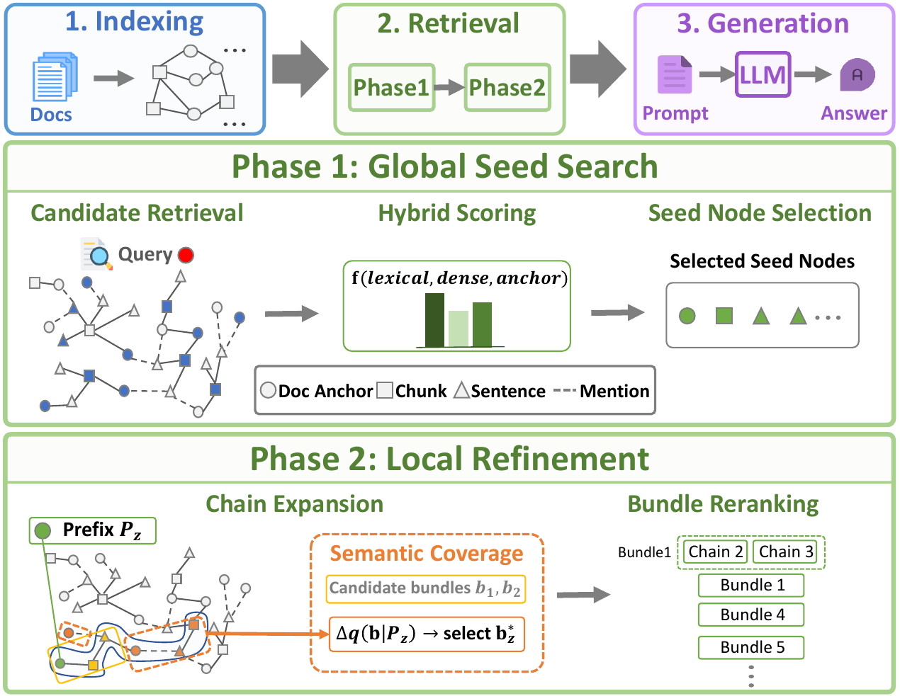

# GRef-RAG

**GRef-RAG: Is Broader Retrieval Always Better for GraphRAG?**

Junghyun Oh, Jin-woo Lee, and Sungsu Lim

Findings of EACL 2027

GRef-RAG (Graph Retrieval with Evidence Refinement for RAG) retrieves document anchors, chunks, and sentences in **Global Seed Search**. **Local Refinement** expands mention-linked evidence chains, assembles evidence bundles, and reranks them using semantic coverage before rendering the QA context.



This release runs GRef-RAG in the common-prompt and method-native settings on the four Wikipedia-based cohorts. It includes baseline scoring adapters, matched-budget controls, and saved scores for replaying the main comparisons. [Reproduction scope](docs/evaluation.md#reproduction-scope)

## Verify the published results on a CPU

Clone the repository and use Python 3.11. This workflow needs no benchmark downloads, model weights, or inference server.

```bash
git clone https://github.com/Ojung-ii/GRef-RAG.git
cd GRef-RAG
python3.11 -m venv .venv-replay
source .venv-replay/bin/activate
python -m pip install -r requirements-replay.txt
python -m gref_rag verify-release --output outputs/camera-ready-verification.json
```

The verifier checks 459 reported values at their displayed precision, using saved per-question scores, token counts, and archived measurements. It reruns the paired statistics and exits with status 1 on a mismatch. Fresh model outputs and latency measurements come from the GPU workflow below. To exercise the indexing, saved-context generation, scoring, and comparison entry points with a synthetic fixture, install `pytest==9.0.3` and run `python -m pytest -q` in the same environment. [Verification scope](reproducibility/RESULT_PROVENANCE.md#cpu-verification-scope)

## Set up fresh model runs

Use Python 3.11 and two terminals at the repository root. In this example, physical GPU 0 serves Qwen2.5-7B-Instruct through vLLM, and physical GPU 1 runs the GRef-RAG client. The client loads NV-Embed-v2 locally during indexing and query retrieval and sends QA requests to vLLM. The two processes use separate Python environments and PyTorch versions.

### Terminal 1 — Qwen generation on GPU 0

```bash
python3.11 -m venv .venv-vllm
source .venv-vllm/bin/activate
python -m pip install -r requirements-vllm.txt
CUDA_VISIBLE_DEVICES=0 vllm serve Qwen/Qwen2.5-7B-Instruct \
  --revision a09a35458c702b33eeacc393d103063234e8bc28 \
  --host 127.0.0.1 --port 8011 --max-model-len 16500 \
  --gpu-memory-utilization 0.35 --enable-prefix-caching
```

This example uses the default model RoPE configuration. Serving parameters from the archived HotpotQA replays are listed in the evaluation guide. [Serving profiles](docs/evaluation.md#processes-and-serving-profiles)

### Terminal 2 — NV-Embed-v2 and retrieval on GPU 1

The reference client used PyTorch 2.6.0 with CUDA 12.4 and Transformers 4.57.6.

```bash
python3.11 -m venv .venv
source .venv/bin/activate
python -m pip install torch==2.6.0 --index-url https://download.pytorch.org/whl/cu124
python -m pip install -r requirements.txt

export CUDA_VISIBLE_DEVICES=1
export EMBED_DEVICE=cuda:0
export GREF_RAG_LLM_BASE_URL=http://127.0.0.1:8011/v1
export NVEMBED_MODEL_PATH="$(hf download nvidia/NV-Embed-v2 \
  --revision 3fa59658547db50a1e8e3346cf057fd0c77ed6ef)"
```

`cuda:0` is the first CUDA device visible inside the masked client process. Use `VLLM_API_KEY` if your generation endpoint requires authentication. On one GPU, use `CUDA_VISIBLE_DEVICES=0` in both terminals. Run retrieval with `--retrieval-only --save-context` first, let it exit, and then start vLLM and run `generate` on the saved contexts.

Pass `NVEMBED_BATCH_SIZE=8` to the `index` command if the default batch of 32 exceeds available GPU memory. Keep the embedding model, precision, and batch size in your run record when comparing newly built indexes.

## Data

The four main cohorts use the questions and separate retrieval corpus from a pinned HippoRAG 2 release. Each QA file contains 1,000 questions. MultiHop-RAG news is a separate evaluation with 2,556 questions.

| Dataset | Questions | Retrieval corpus | Additional input |
| --- | --- | --- | --- |
| HotpotQA | [QA JSON](https://huggingface.co/datasets/osunlp/HippoRAG_2/resolve/488c53fb27dd28f70412e18004bd49f791600574/hotpotqa.json) | [Corpus JSON](https://huggingface.co/datasets/osunlp/HippoRAG_2/resolve/488c53fb27dd28f70412e18004bd49f791600574/hotpotqa_corpus.json) | |
| 2WikiMultiHopQA | [QA JSON](https://huggingface.co/datasets/osunlp/HippoRAG_2/resolve/488c53fb27dd28f70412e18004bd49f791600574/2wikimultihopqa.json) | [Corpus JSON](https://huggingface.co/datasets/osunlp/HippoRAG_2/resolve/488c53fb27dd28f70412e18004bd49f791600574/2wikimultihopqa_corpus.json) | [Official archive with answer aliases](https://www.dropbox.com/s/ms2m13252h6xubs/data_ids_april7.zip?dl=1) |
| MuSiQue | [QA JSON](https://huggingface.co/datasets/osunlp/HippoRAG_2/resolve/488c53fb27dd28f70412e18004bd49f791600574/musique.json) | [Corpus JSON](https://huggingface.co/datasets/osunlp/HippoRAG_2/resolve/488c53fb27dd28f70412e18004bd49f791600574/musique_corpus.json) | |
| PopQA | [QA JSON](https://huggingface.co/datasets/osunlp/HippoRAG_2/resolve/488c53fb27dd28f70412e18004bd49f791600574/popqa.json) | [Corpus JSON](https://huggingface.co/datasets/osunlp/HippoRAG_2/resolve/488c53fb27dd28f70412e18004bd49f791600574/popqa_corpus.json) | |
| MultiHop-RAG news | [QA JSON](https://huggingface.co/datasets/yixuantt/MultiHopRAG/resolve/71ac0d0bd1f951d2d6b70311f7d2ae404e1ffa82/MultiHopRAG.json) | [Corpus JSON](https://huggingface.co/datasets/yixuantt/MultiHopRAG/resolve/71ac0d0bd1f951d2d6b70311f7d2ae404e1ffa82/corpus.json) | |

The following commands populate `data/{hotpotqa,2wiki,musique,popqa}/` and verify checksums, aliases, and ordered question IDs.

```bash
python -m gref_rag data --with-2wiki-aliases
python -m gref_rag data --verify-only --with-2wiki-aliases
```

Use `--dataset hotpotqa` to download a single main cohort. The `--with-2wiki-aliases` option extracts the paper evaluator's answer-ID aliases and demonyms from the official archive. Use `python -m gref_rag news-data` for the separate news input files. Set `--data-root` or `GREF_RAG_DATA_DIR` to choose a different local directory. [Versions, hashes, and source terms](reproducibility/DATASET_PROVENANCE.md)

## Run the experiments

In terminal 2, build one index per dataset and reuse it for both prompt settings.

The commands below use the public configuration tested in the HotpotQA GPU reproduction. For the historical common-prompt candidate-pool setting, pass `--config configs/common-archived-uncapped.yaml` for HotpotQA, 2Wiki, and MuSiQue. The original PopQA common-prompt run enabled the global cap at 80. The archived settings and the tested GPU rerun are documented in the evaluation guide and reproduction artifacts. [Archived retrieval settings](docs/evaluation.md#archived-retrieval-settings) · [HotpotQA GPU reproduction](res/hotpotqa-gpu-reproduction.json)

```bash
python -m gref_rag index --dataset hotpotqa --index-dir indexes/hotpotqa

python -m gref_rag run --dataset hotpotqa --index-dir indexes/hotpotqa \
  --config configs/common.yaml --output outputs/hotpotqa-common

python -m gref_rag run --dataset hotpotqa --index-dir indexes/hotpotqa \
  --config configs/native.yaml --output outputs/hotpotqa-native
```

Add `--limit 10` to run the first ten manifest questions. Pass `--retrieval-only --save-context` to run the search stage without a generation server. Pass the resulting `predictions.jsonl` as `--contexts` to the `generate` command with the same dataset, config, and limit. Use `--save-evidence` to export the ranked evidence bundles for provenance analysis.

Compare a full HotpotQA common-prompt run with the historical reference to locate the first differing stage. The `compare` command reports per-stage mismatch counts and returns status 1 when any stage differs. New dense indexes and generation servers can change results even with the pinned settings. [Recorded full-cohort comparisons](res/README.md#live-validation)

```bash
python -m gref_rag compare \
  --predictions outputs/hotpotqa-common/predictions.jsonl \
  --metrics outputs/hotpotqa-common/metrics.json \
  --reference res/hotpotqa-common-reference.jsonl \
  --output outputs/hotpotqa-common/parity.json
```

| Setting | QA prompt | Paper token count |
| --- | --- | --- |
| Common | Shared short-answer prompt with Qwen, temperature 0, top-p 1, and a 64-token output cap | Rendered context including evidence headers and references |
| Native | GRef-RAG evidence-aware prompt and a question-only choice constraint for entity-choice comparisons | Full chat-template model input |

Native reproduction uses the exact historical role string and per-dataset renderers from the executed runs. The appendix updates the role string to the final method name. Set `generation.native_role: GRef-RAG` to use that wording. Full settings and baseline adapter inputs are in [the evaluation guide](docs/evaluation.md).

## Evaluation and results

Each run writes `predictions.jsonl`, `metrics.json`, and `run_manifest.json`. The evaluator reports EM, token-level F1, source recall, context and full-input tokens, F1 per 1,000 context tokens, online latency, and index-build time where measured. JSON EM/F1 are fractions. Index-build timing is measured by `index` and reused with the same index.

To replay the main paired F1 comparisons on a CPU, install `requirements-replay.txt` and run `python -m gref_rag statistics --output outputs/main-paired-statistics.csv`. This replay uses the released score ledger and fixed query IDs.

Use `python -m gref_rag matched-budget-statistics --output outputs/matched-budget-summary.csv` to replay the matched-budget table. To run fresh QA at the three budgets, use the GRef-RAG and KG²RAG retrieval exports with the [matched-budget command](docs/evaluation.md#matched-context-budgets).

Use `evaluate` with `--recall-adapter` to score saved baseline predictions, or `generate` with the common configuration to apply the same QA prompt to saved baseline contexts. Align incoming artifacts to the fixed benchmark IDs. See [adapter formats and comparison caveats](docs/evaluation.md) and [official results and parity checks](res/README.md).

| GRef-RAG | Common EM / F1 (%) | Context tokens | Native EM / F1 (%) | Full-input tokens |
| --- | ---: | ---: | ---: | ---: |
| HotpotQA | 32.4 / 39.3 | 480 | 50.7 / 62.9 | 734 |
| 2Wiki | 15.2 / 17.3 | 484 | 49.2 / 55.5 | 761 |
| MuSiQue | 5.8 / 8.3 | 558 | 20.1 / 29.1 | 1015 |
| PopQA | 40.3 / 50.2 | 522 | 47.7 / 60.6 | 1014 |

The PopQA native row uses the question-only rerun on the same 1,000 queries. An earlier manuscript used a run that allowed benchmark subject names and Wikipedia titles to seed retrieval. The common-prompt PopQA result used question-only retrieval throughout. [PopQA correction and validation](res/README.md#live-validation)

## Code map

| Module | Purpose |
| --- | --- |
| `graph.py`, `index.py`, `embedding.py` | Corpus graph, mention edges, dense index construction, and NV-Embed-v2 |
| `retrieval/global_seed_search.py` | BM25, dense, and document-anchor rank fusion |
| `retrieval/local_refinement.py`, `retrieval/semantic_coverage.py` | Chain Expansion and Bundle Reranking |
| `rendering.py`, `prompts.py`, `generation.py` | Context rendering, QA prompts, and generation |
| `evaluation/metrics.py`, `evaluation/recall.py` | Shared QA/cost metrics and method-specific recall |
| `pipeline.py`, `__main__.py` | Integration and experiment CLI |

## Reproducibility

- [Run manifest guide](reproducibility/RUN_MANIFEST.md) and [machine-readable run manifest](reproducibility/run_manifest.csv)
- [Dataset provenance and download commands](reproducibility/DATASET_PROVENANCE.md)
- [Result provenance and verification scope](reproducibility/RESULT_PROVENANCE.md)

## Citation

Junghyun Oh, Jin-woo Lee, and Sungsu Lim. 2027. *GRef-RAG: Is Broader Retrieval Always Better for GraphRAG?* Findings of EACL 2027.

## License

The GRef-RAG implementation is licensed under [MIT](LICENSE). Obtain third-party models and datasets under their publishers' terms. [Dataset licenses](reproducibility/DATASET_PROVENANCE.md#source-terms-and-distribution) · [Third-party resources](docs/evaluation.md#third-party-resources)
